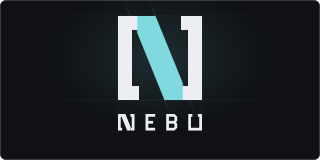

<p align="center">
  
</p>

<p align="center">
  <a href="https://github.com/nickheyer/nebu/releases/latest"></a>
  <a href="https://aur.archlinux.org/packages/nebu-bin"></a>
  <a href="https://github.com/nickheyer/nebu/pkgs/container/nebu"></a>
  <a href="LICENSE-MIT"></a>
</p>

<p align="center">Nebu manages model weights and inference runtimes. Named after the Nebuchadnezzar from The Matrix.</p>

<table>
  <tr><td><b>Runtimes</b></td><td>llama.cpp, vLLM, SGLang, NeMo, stable-diffusion.cpp</td></tr>
  <tr><td><b>Diffusers</b></td><td>image and video generation</td></tr>
  <tr><td><b>Runtime installation</b></td><td>use an existing binary, download one, or build from source</td></tr>
  <tr><td><b>Model sources</b></td><td>Hugging Face, GitHub, Ollama, ModelScope, Civitai, Kaggle, NGC, CSGHub, OCI registries, git, mirrors, and local directories</td></tr>
  <tr><td><b>APIs</b></td><td>OpenAI, Anthropic, Ollama</td></tr>
  <tr><td><b>Tools</b></td><td>Shipped with web search through SearXNG or Brave</td></tr>
  <tr><td><b>MCP</b></td><td>Available at <code>/mcp</code> for Claude Code, Claude Desktop, and other clients</td></tr>
  <tr><td><b>Discord</b></td><td>text, images, video, personas, automations, and sharding</td></tr>
  <tr><td><b>Platforms</b></td><td>Linux, macOS, Windows, and FreeBSD</td></tr>
  <tr><td><b>SSO/OIDC</b></td><td>Supports all OpenID Connect Providers. See <code>compose.yaml</code> or <code>packaging/config.yaml</code></td></tr>
  <tr><td><b>Local Auth</b></td><td>Local username/password enabled by default in the web ui. Token auth enabled after a token is generated in user settings.</td></tr>
</table>

## Install

### Arch Linux

```sh
yay -S nebu-bin # or nebu to build from source
systemctl --user enable --now nebu.service
```

### Docker

```sh
docker run -d --name nebu -p 127.0.0.1:8484:8484 \
  -v nebu:/var/lib/nebu -v nebu-cache:/var/cache/nebu \
  ghcr.io/nickheyer/nebu

docker run -d --name nebu -p 127.0.0.1:8484:8484 --gpus all \
  -v nebu:/var/lib/nebu -v nebu-cache:/var/cache/nebu \
  ghcr.io/nickheyer/nebu:cuda
```

### Docker Compose

```sh
git clone https://github.com/nickheyer/nebu && cd nebu
sudo install -d -o 10001 -g 10001 /srv/nebu /srv/nebu-cache && mkdir -p models

docker compose up -d                                         # CPU
docker compose -f compose.yaml -f compose.nvidia.yaml up -d  # NVIDIA
NEBU_VIDEO_GID=$(getent group video | cut -d: -f3) \
NEBU_RENDER_GID=$(getent group render | cut -d: -f3) \
  docker compose -f compose.yaml -f compose.rocm.yaml up -d  # AMD
```

### Binary

Prebuilt binaries available for all platforms at [GitHub Releases](https://github.com/nickheyer/nebu/releases)

```sh
curl -fsSL https://api.github.com/repos/nickheyer/nebu/releases/latest \
  | grep -o 'https://[^"]*linux_amd64.tar.gz' | xargs curl -fsSL | tar -xz nebu
./nebu serve
```

## Build

Requires Go 1.27, Docker, and Make.

```sh
make gen
make build
```

See [Makefile](Makefile) for other commands.
